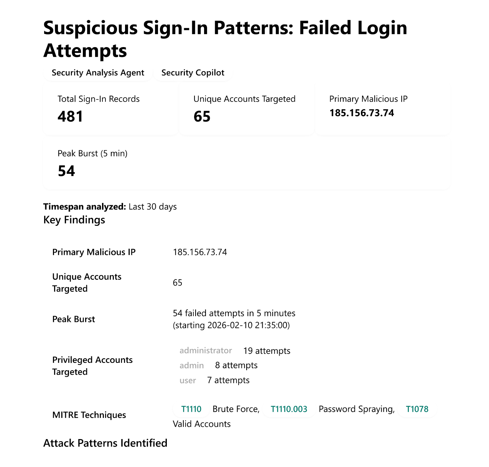
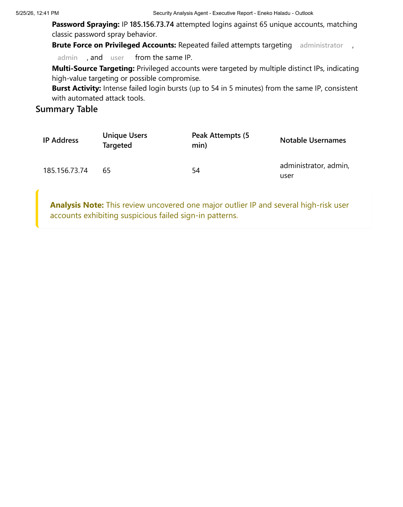
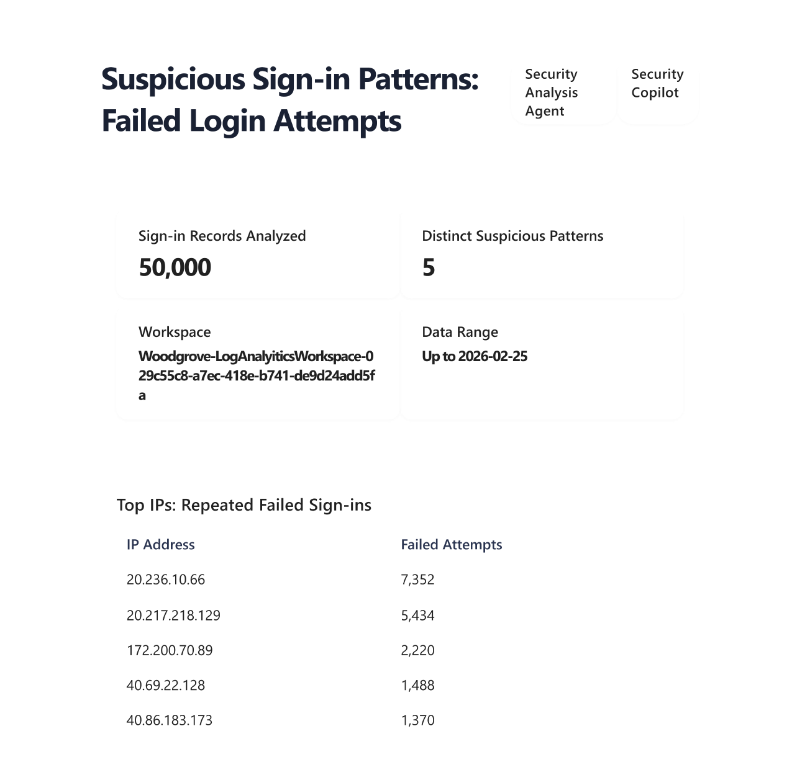
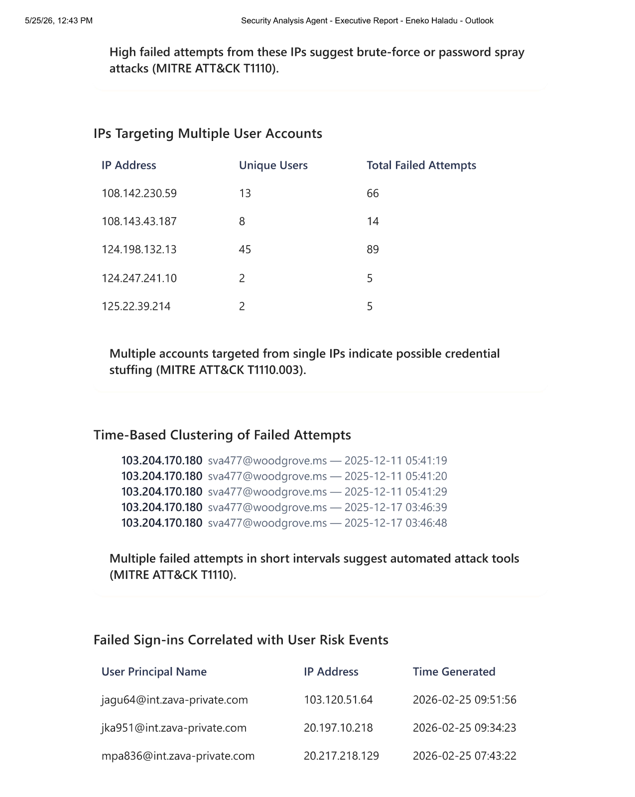
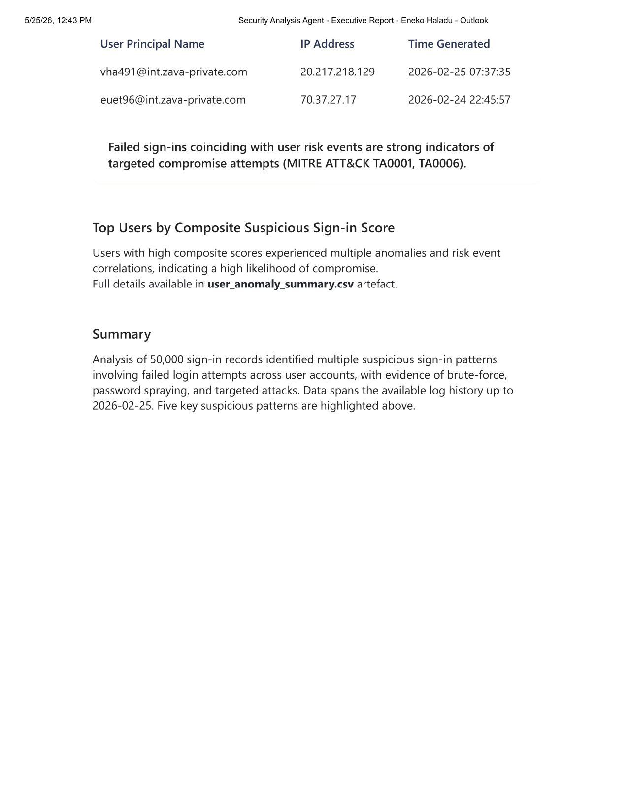

# Security Analyst Agent — OuterLoop Automation

**Author:** Hariram Subramanian Gopal

## Overview

This folder contains three Azure Logic App ARM templates that automate the **Security Analyst Agent** (OuterLoop) in Microsoft Security Copilot. Each template:

1. Runs on a **recurring schedule** (configurable).
2. Sends a natural-language security analysis prompt to the `SecurityAnalysisAgentOuterLoop` skill.
3. Generates an **executive HTML dashboard** from the agent's findings.
4. **Emails the report** via Office 365.

Three variants are provided, depending on your data source:

| Template | Data Source | File |
|---|---|---|
| **Email + Data Lake** | Microsoft Sentinel Data Lake | `azuredeploy-email-datalake.json` |
| **Email + Log Analytics** | Microsoft Sentinel Log Analytics Workspace | `azuredeploy-email-LAW.json` |
| **Email + Defender XDR** | Microsoft Defender XDR | `azuredeploy-email-DefenderXDR.json` |

> For more details on the Security Analyst Agent, see the [official documentation](https://learn.microsoft.com/en-us/copilot/security/security-analyst-agent).

## How It Works

```
Recurrence ──▶ Security Copilot Prompt ──▶ HTML Dashboard ──▶ Email
 Trigger        (OuterLoop skill)          Generation         (O365)
```

The Logic App uses the `Microsoft.Security.AdvancedAnalystAgent` skillset and automatically appends *"This is the final intent, do not ask clarification questions."* to your prompt to ensure unattended execution.

## Prerequisites

- **Security Copilot** license enabled on the tenant.
- **Microsoft Sentinel** workspace (for Sentinel variants):
  - **Data Lake** variant → a Sentinel Data Lake workspace name.
  - **Log Analytics** variant → the Log Analytics workspace name, subscription ID, and resource group name.
- **Microsoft Defender XDR** enabled on the tenant (for Defender XDR variant).
- **Contributor** role on the target Azure resource group.
- An **Office 365** mailbox for sending the report email.

## Deployment

### Option 1 — Sentinel Data Lake

[](https://portal.azure.com/#create/Microsoft.Template/uri/https%3A%2F%2Fraw.githubusercontent.com%2FAzure%2FSecurity-Copilot%2Fmain%2FLogic%2520Apps%2FSecurityAnalysisAgent-OuterLoop%2Fazuredeploy-email-datalake.json)

| Parameter | Description | Default |
|---|---|---|
| `PlaybookName` | Name of the Logic App | `SecurityAnalysisAgent-OuterLoop-Email-DataLake` |
| `UserRequest` | The security analysis prompt | *Identify suspicious sign-in patterns…* |
| `email` | Recipient email address | *(required)* |
| `SentinelDataLakeWorkspaceName` | Sentinel Data Lake workspace name | *(required)* |
| `RecurrenceIntervalInDays` | How often the Logic App runs (days) | `3` |
| `RecurrenceTimeZone` | Time zone for the schedule | `India Standard Time` |

### Option 2 — Log Analytics Workspace

[](https://portal.azure.com/#create/Microsoft.Template/uri/https%3A%2F%2Fraw.githubusercontent.com%2FAzure%2FSecurity-Copilot%2Fmain%2FLogic%2520Apps%2FSecurityAnalysisAgent-OuterLoop%2Fazuredeploy-email-LAW.json)


| Parameter | Description | Default |
|---|---|---|
| `PlaybookName` | Name of the Logic App | `SecurityAnalysisAgent-OuterLoop-Email` |
| `UserRequest` | The security analysis prompt | *Identify suspicious sign-in patterns…* |
| `email` | Recipient email address | *(required)* |
| `LogAnalyticsWorkspaceSubscriptionId` | Subscription ID of the LAW | *(required)* |
| `LogAnalyticsWorkspaceResourceGroupName` | Resource group of the LAW | *(required)* |
| `LogAnalyticsWorkspaceName` | Name of the LAW | *(required)* |
| `RecurrenceIntervalInDays` | How often the Logic App runs (days) | `3` |
| `RecurrenceTimeZone` | Time zone for the schedule | `India Standard Time` |

### Option 3 — Defender XDR

[](https://portal.azure.com/#create/Microsoft.Template/uri/https%3A%2F%2Fraw.githubusercontent.com%2FAzure%2FSecurity-Copilot%2Fmain%2FLogic%2520Apps%2FSecurityAnalysisAgent-OuterLoop%2Fazuredeploy-email-DefenderXDR.json)

| Parameter | Description | Default |
|---|---|---|
| `PlaybookName` | Name of the Logic App | `SecurityAnalysisAgent-OuterLoop-Email-DefenderXDR` |
| `UserRequest` | The security analysis prompt | *Identify suspicious sign-in patterns…* |
| `email` | Recipient email address | *(required)* |
| `RecurrenceIntervalInDays` | How often the Logic App runs (days) | `3` |
| `RecurrenceTimeZone` | Time zone for the schedule | `India Standard Time` |

> This variant uses Defender XDR as the data source with no additional workspace configuration required.

## Post-Deployment Steps

1. **Authorize API connections** — Open the Logic App in the Azure portal, go to **API connections**, and authorize both the **Security Copilot** and **Office 365** connectors.
2. **Adjust the recurrence schedule** — Modify the interval and time zone if needed.
3. **Run the Logic App** — Trigger a manual run and verify you receive the email report.

## Sample Email Output

The Logic App delivers an executive HTML dashboard directly to your inbox. Below are examples of the output:

### Example 1 — Sentinel Data Lake (Brute Force Detection)





### Example 2 — Log Analytics Workspace (Sign-In Pattern Analysis)







## Related Resources

- [Security Analyst Agent — Official Documentation](https://learn.microsoft.com/en-us/copilot/security/security-analyst-agent)
- [Security Copilot Logic Apps Connector](https://learn.microsoft.com/en-us/connectors/securitycopilot/)
